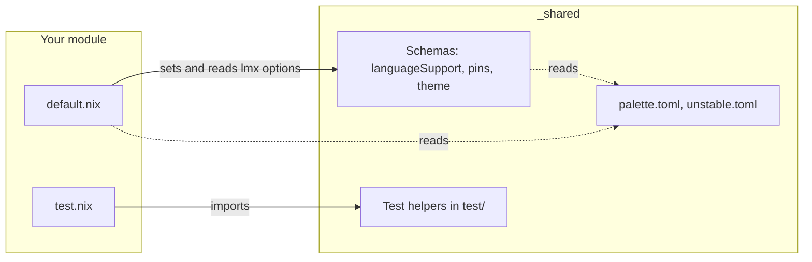
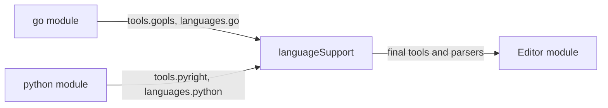

# Shared helpers

`_shared` is the toolbox for catalog module authors: option schemas that let
modules exchange data, helpers for `test.nix` and common data. It knows no
module names. Your module's checks and policy stay in your module.



Every evaluated system loads the root `*.nix` schemas; `test.nix` is the shared
layer's own test export. Everything else is used only through an explicit
import.

## Find what you need

| I want to | Use |
| -- | -- |
| Check that my module installs a package or sets an option | [`test/helpers.nix`](#check-a-configuration) |
| Check each version line of my module | [`test/lines.nix`](#test-version-lines) |
| Add a language to `[toolchains]` | [`lib/toolchain.nix` and `test/toolchain.nix`](#define-a-toolchain) |
| Let a C compiler find headers and libraries in the system profile | [`lib/compiler.nix`](#build-against-the-system-profile) |
| Check which line's executable a command runs | [`test/profile-commands.nix`](#check-profile-commands) |
| Take packages from another Nixpkgs revision | [`lmx.pins` and `pinned`](#use-another-nixpkgs-revision) |
| Take each version line from the base, unstable or a snapshot | [`lib/release.nix`](#resolve-a-version-line) |
| Take a module without lines from nixos-unstable | [`lib/source.nix`](#resolve-a-version-line) |
| Offer a language server or parsers to editors | [`languageSupport`](#share-language-tools) |
| Use the guest's theme colors | [`theme`](#theme-colors) |
| Drive a terminal program or a language server in `run` | [Process helpers](#drive-processes) |

## Check a configuration

[test/helpers.nix](test/helpers.nix) evaluates public entry points and checks
the result:

```nix
{ evalSystem, pkgs, lib }:
let
  helpers = import ../../_shared/test/helpers.nix { inherit evalSystem pkgs lib; };
  configuration = helpers.evaluate [ ./default.nix ];
in
{
  eval.package = helpers.installed configuration pkgs.gh;
  run.commands = import ./test/run.nix {
    inherit pkgs;
    profile = helpers.profileFor configuration;
  };
}
```

| Helper | Result |
| -- | -- |
| `evaluate modules` | Configuration record `{ config; pkgs; lib; }` |
| `installed configuration package` | `true` when `systemPackages` contains the package |
| `installedAsDeclared configuration package` | The same, with the package's declared priority |
| `selectedPackage configuration package` | `true` when the package beats others with the same name |
| `packagePriority package` | The package's priority; `5` by default |
| `profileFor configuration` | The system profile for `run` checks |
| `sourceFor configuration source` | The packages and pins of a source such as `"unstable"`, as the evaluated system resolves them |
| `verify label value configuration` | `true`, or an error naming `label` when `value` is not `true` |

A profile is the evaluated `config.system.path`. Running it proves commands, not
activation.

## Test version lines

For a module with `versions` in `module.toml`, [test/lines.nix](test/lines.nix)
evaluates each line's public entry and calls your callbacks:

```nix
lineTests = import ../../_shared/test/lines.nix {
  inherit evalSystem pkgs lib;
  moduleDirectory = ./.;
  checkLine = { line, configuration }: import ./test/check.nix { inherit line configuration; };
  runLine = { line, configuration }: import ./test/smoke.nix { inherit line configuration; };
};
```

`checkLine` returns a Boolean; `runLine` is optional and returns a derivation.
Export `inherit (lineTests) eval run;` to get `eval."line-<line>"` and
`run."commands-<line>"`. The helper checks lines one by one. Whether several
lines work together is your module's decision: export your own `eval.allLines`
or an expected failure such as `fails.twoLines`.

<details>
<summary>Other results and laziness</summary>

| Result | Value |
| -- | -- |
| `lines` | Declared lines in numeric order, for example `1.9`, `1.10` |
| `metadata` | Parsed `module.toml` |
| `configurations.<line>` | Configuration record for `versions/<line>.nix` |
| `defaultConfiguration` | Configuration record for `default.nix` |
| `allConfiguration` | Configuration record importing every line |

Reading `lines` or `metadata` evaluates no system. Each configuration is
evaluated once and shared by the callbacks that use it.

</details>

## Define a toolchain

[lib/lines.nix](lib/lines.nix) is the module with version lines: it declares
`lmx.internal.<name>.versions` and `.packages`, recommends the default line,
resolves each selected line through `lib/release.nix`, installs what the line
supplies, warns at end of life and writes the help card with the selected
versions in its title. The module keeps one file with what differs between
modules and makes `default.nix` the module itself:

```nix
# default.nix
import ../../_shared/lib/lines.nix (import ./lines.nix)

# versions/18.nix, through module.nix
version: {
  imports = [ ./default.nix ];
  lmx.internal.postgres.versions = [ version ];
}
```

| Field of `lines.nix` | Meaning |
| -- | -- |
| `name`, `title`, `directory`, `page` | The module name, its product name, its directory and its page under `docs.limanix.dev` |
| `main`, `packages` | The package whose version names the line, and the `packages.nix` function that resolves a line's packages |
| `line` | A function of `{ version, tools, rank, priority, config, lib, pkgs }` with the line's own configuration |
| `commands`, `versioned`, `tips` | The help card: commands on PATH, the per-line command names, the tips |
| `single`, `priorityOffset`, `product`, `extra` | One line at a time; a lower package priority; another product name in warnings; configuration outside any line |

[lib/toolchain.nix](lib/toolchain.nix) is a lines module that also offers a
language server: `tool`, `parsers`, `provider` and `systemPackages` describe the
server, the Tree-sitter parsers and the installed packages of a line, and the
newest selected line's server wins. [test/toolchain.nix](test/toolchain.nix)
exports the tests of such a module: `eval.line-<line>`, `eval.allLines`,
`eval.userOverride`, `run.commands-<line>`, `run.languageServer`,
`run.userOverride` and `run.allLines`. The module adds its `commands` smoke
test, the `coexisting` package attributes, the `profileCommands` of the shared
profile and, when it has them, extra `eval` cases and `builds`.

## Build against the system profile

[lib/compiler.nix](lib/compiler.nix) takes a Nixpkgs compiler wrapper, such as
`gcc15` or `clang_22`, and returns one that searches
`/run/current-system/sw/include` after its own and the libc headers, and
`/run/current-system/sw/lib` after the directories on its command line. Dynamic
links get the same directory as their last `RUNPATH` entry, so a program falls
back to the system profile only for libraries it finds nowhere else. Pass
`prefix` to point a test compiler at another directory.

```nix
gcc = import ../../_shared/lib/compiler.nix { compiler = packages.gcc15; };
```

NixOS links only some directories into the profile: the module that installs the
compiler adds `/include` to `environment.pathsToLink` and `dev` to
`environment.extraOutputsToInstall`.

## Check profile commands

When several lines install the same command,
[test/profile-commands.nix](test/profile-commands.nix) checks which executable
the profile resolves to:

```nix
run.newestCommand = import ../../_shared/test/profile-commands.nix {
  inherit pkgs;
  profile = helpers.profileFor lineTests.allConfiguration;
  expectedCommands.go = "${newestGo}/bin/go";
};
```

> [!TIP]
>
> The platform sorts `systemPackages` by store path and then priority, and
> import order never decides a collision. Give colliding commands explicit
> priorities with `lib.setPrio`.

## Use another Nixpkgs revision

Declare the revision and its hash in `lmx.pins`, then read packages from the
`pinned` module argument:

```nix
{ pinned, ... }:
{
  lmx.pins."<revision>" = "<sha256>";
  environment.systemPackages = [ pinned."<revision>".go_1_22 ];
}
```

- Write the hash as a plain constant, without `mkDefault` or `mkForce`. Modules
  that declare the same revision with the same hash agree; different hashes
  fail.
- Use `pinned` only in configuration values, never in `imports` or option
  declarations.
- An unfree package needs its name in `nixpkgs.config.allowUnfreePackages`;
  pinned package sets follow that list.
- The `unstableSource` module argument holds the `rev` and `sha256` of the
  catalog's nixos-unstable revision from [unstable.toml](unstable.toml). A
  platform that offers packages from it declares that pin, then reads
  `pinned.${unstableSource.rev}`; modules use `lib/source.nix` instead.

<details>
<summary>How pinned package sets are built</summary>

Each revision is imported lazily, once per evaluated system, for the system's
platform and without overlays. An unused revision is never downloaded. The
unfree check compares names with the pinned source's own `lib.getName`. A shared
source does not guarantee a binary-cache hit; local builds follow the
[local-build policy](../README.md#local-builds-and-runtime).

</details>

## Resolve a version line

A versioned module whose lines come from Nixpkgs lists them in `releases.nix`,
one record per line:

```nix
{
  "1.27" = { source = "base"; package = "go_1_27"; endOfLife = false; };
  "1.28" = { source = "unstable"; package = "go_1_28"; endOfLife = false; };
  "1.25" = {
    source = { rev = "<revision>"; sha256 = "<sha256>"; };
    package = "go_1_25";
    version = "1.25.13";
    endOfLife = true;
  };
}
```

| Source | Packages | Version check |
| -- | -- | -- |
| `"base"` | The system's `pkgs`, from `flake.lock` | The line: `1.27` accepts any `1.27.x` |
| `"unstable"` | The catalog's nixos-unstable revision in [`unstable.toml`](unstable.toml) | The line |
| `{ rev, sha256 }` | That snapshot | The exact `version` of the record |

[lib/release.nix](lib/release.nix) resolves the selected line. The record comes
back with the line's package set, the pin it needs and its version check:

```nix
{ version, pinned, pkgs }:
let
  release = import ../../_shared/lib/release.nix {
    releases = ./releases.nix;
    line = version;
    inherit pkgs pinned;
  };
  go = release.packages.${release.package};
in
assert release.matches go.version;
{ inherit go; }
```

Declare `release.pins` in `lmx.pins`: it never evaluates a package set. Other
fields of the record are the module's own, and `release.resolve` resolves one of
them as a source too, such as a separately pinned compiler.

A module without lines takes its packages from a source directly with
[lib/source.nix](lib/source.nix), such as a fast-moving CLI from unstable:

```nix
{ pkgs, pinned, ... }:
let
  unstable = import ../../_shared/lib/source.nix {
    source = "unstable";
    inherit pkgs pinned;
  };
in
{
  lmx.pins = unstable.pins;
  environment.systemPackages = [ unstable.packages.claude-code ];
}
```

- Lines from the base and unstable record no version and receive their patch
  releases: the Check update flow moves both revisions every Monday.
- A snapshot keeps its exact version and never moves.
- The harness requires `releases.nix` to map exactly the lines of `module.toml`.
  The resolver rejects a record without a valid source, package or `endOfLife`,
  a version on a line from the base or unstable, and a snapshot without one.

## Share language tools

Language modules publish their tools and parsers; editor modules read the final
result:



A provider declares a complete tool record. Its module computes `rank` as the
number of declared releases older than the selected release; newer releases get
a larger rank and a lower, stronger `mkOverride` priority:

```nix
lmx.capabilities.languageSupport = {
  languages.go.parsers = [ "go" "gomod" ];
  tools.gopls = lib.mkOverride (1000 - rank) {
    package = tools.gopls;
    command = "${tools.gopls}/bin/gopls";
    languages = [ "go" ];
  };
};
```

- A tool record is replaced as a whole: the strongest priority wins with all its
  fields. Use `lib.mkOverride (1000 - rank)` with `0 <= rank < 100` so a newer
  line wins. A user's ordinary definition or `mkForce` still overrides it.
- Equal records at the same priority agree; different records fail evaluation.
- The provider installs the winning `package`. A consumer maps `command` and
  `args` into its own settings.
- Parser lists from all modules add up without duplicates and need no tool.

<details>
<summary>Fields</summary>

| Field | Type |
| -- | -- |
| `tools.<identity>.package` | Package; required |
| `tools.<identity>.command` | Executable path; required |
| `tools.<identity>.args` | List of strings; default `[]` |
| `tools.<identity>.languages` | List of language names; default `[]` |
| `languages.<language>.parsers` | List of parser names; default `[]` |

The tool identity names the tool itself, such as `gopls`, not the module that
provides it.

</details>

## Drive processes

[test/terminal.py](test/terminal.py) runs a command in a pseudo-terminal with
deadlines and bounded output. Add `PYTHONPATH = ../../../_shared/test;` to the
`runCommand` environment:

```python
from terminal import TerminalProcess

with TerminalProcess([program], env=environment) as process:
    process.until(lambda: b"ready" in process.output, timeout=5)
    process.send(b"q")
```

[test/lsp-smoke.py](test/lsp-smoke.py) starts a language server and checks that
it initializes and shuts down:

```sh
python ${../../../_shared/test/lsp-smoke.py} --timeout 10 ${profile}/bin/gopls
```

## Theme colors

`lmx.capabilities.theme` holds the guest's colors: the terminal's own colors, or
a Catppuccin flavor and its colors. Read it in configuration values:

```nix
{ config, ... }:
let
  inherit (config.lmx.capabilities.theme) flavor palette ansi;
in
{
  # flavor == "system" by default: ansi.blue == 4, the terminal's blue
  # flavor == "mocha": palette.blue == "#89b4fa"
}
```

- `flavor` is `system`, the default, or `latte`, `frappe`, `macchiato` or
  `mocha`. A system has one flavor: equal definitions agree, different
  definitions at the same priority fail. The user selects it with `[theme]` in
  `limanix.toml`; modules never set it. Every catalog module with colors reads
  it.
- `palette` is read-only: the flavor's 26 colors by name, such as `blue`, as
  `#rrggbb`. With `system` it holds Mocha's colors, for a tool that knows only
  explicit colors.
- `ansi` is read-only: for each name of `palette`, the terminal color that
  stands for it with `system`. A number from 0 to 15 is one of the terminal's 16
  colors; `null` is its default foreground or background, so the terminal's own
  background shows through. [ansi.toml](ansi.toml) holds the table.
- With `system`, use `ansi` and leave backgrounds to the terminal: the colors
  then follow the theme of the terminal on the Mac, and change with it.
- [palette.toml](palette.toml) copies the four flavors of Catppuccin palette
  v1.8.0 from the revision that `pkgs.catppuccin` packages; a check compares the
  two.

## Change `_shared`

> [!IMPORTANT]
>
> Shared code never names a module, chooses its lines or rebuilds its test
> scenarios. A change under `_shared` makes CI check the whole catalog.

Add code here only when several modules need it without module policy. A root
`*.nix` file is an option schema that every system loads; pure functions belong
in `lib/` and test helpers in `test/`. Check new behavior in `_shared/test.nix`.
